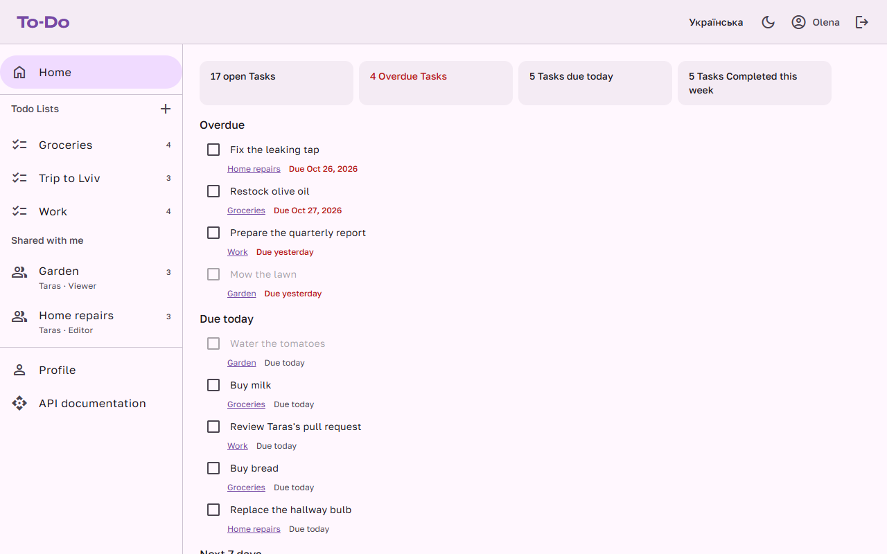
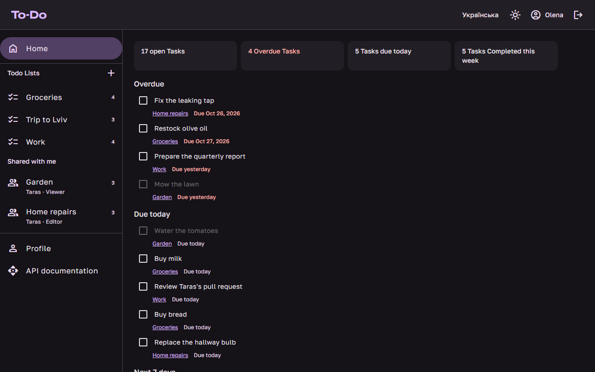
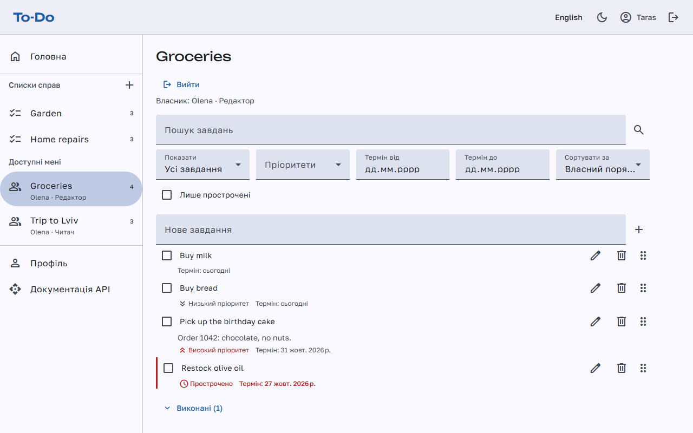
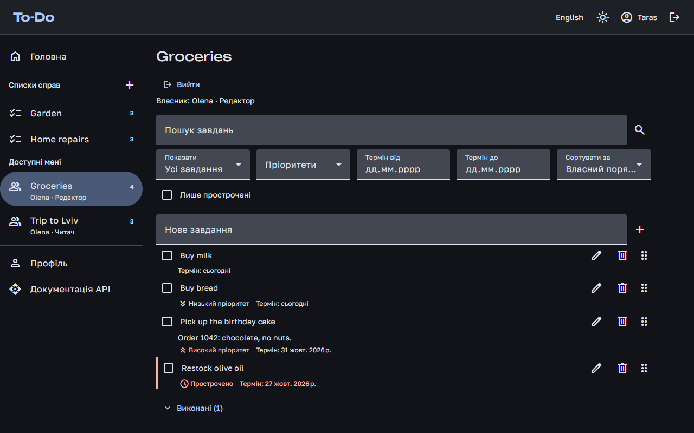
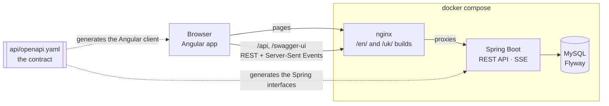

# To-Do

[](https://github.com/RuslanRubtsov/to-do-list/actions/workflows/ci.yml)

A to-do web application in which Users organise their work into Todo Lists of Tasks, Share Todo
Lists with each other as Viewers or Editors, and see each other's changes live. Angular frontend,
Spring Boot REST API, MySQL; English and Ukrainian; light and dark.

Built as a technical-interview showcase: one `docker compose up` starts everything, pre-seeded with
two demo Users, so it can be tried in minutes.

**Live demo:** <https://your-name.duckdns.org> (coming soon), with the [demo Users](#demo) below.

| | |
|---|---|
|  |  |
|  |  |

More in [docs/screenshots](docs/screenshots): each page in both languages and both themes.

## Run it

You need Docker with Compose.

```sh
docker compose up
```

The first start builds the images, which takes a few minutes. Then:

| What | Where |
|---|---|
| The app | <http://localhost> (another port: `FRONTEND_PORT=8000 docker compose up`) |
| Swagger UI, to browse and try the REST API | <http://localhost/swagger-ui/index.html> |
| The OpenAPI contract | <http://localhost/openapi.yaml> |
| Backend health | <http://localhost:8080/actuator/health> |

To try authenticated calls in Swagger UI, call **login** with **Try it out**, then paste the
`accessToken` from its response into **Authorize**.

The live demo runs this same setup on a server, with HTTPS in front:
[deploying it](docs/deployment.md).

## Demo

Two demo Users exist from the first start ([what is seeded](docs/demo-data.md)):

| User | Email | Password | Language |
|---|---|---|---|
| Olena | `olena@example.com` | `todo-demo-1` | English |
| Taras | `taras@example.com` | `todo-demo-1` | Ukrainian |

Olena Shares _Groceries_ with Taras as an Editor and _Trip to Lviv_ as a Viewer; Taras Shares _Home
repairs_ with her as an Editor and _Garden_ as a Viewer.

### Sharing and live updates, in two windows

Log in as Olena in one browser window, and as Taras in a **private window or another browser**: a
session lives in a cookie that windows of one browser profile share.

1. **Dashboard.** Both land on what needs attention across their own and shared Todo Lists:
   Overdue, due today and the next 7 days, with counts. Taras's is in Ukrainian, with its plural
   forms; switch language or theme from the toolbar.
2. **Both open _Groceries_.** Olena owns it; Taras sees _Власник: Olena · Редактор_ (Owner: Olena,
   Editor).
3. **Taras adds a Task.** It appears in Olena's window as soon as it is saved. So does each change
   either of them makes: completing a Task, editing its details, dragging it into another place,
   deleting it.
4. **Both edit the same Task's details.** Whoever saves second is told someone else changed it
   meanwhile, and sees the latest version, instead of silently overwriting it.
5. **Olena renames _Groceries_.** The new name shows at once in Taras's page and drawer.
6. **Taras opens _Trip to Lviv_.** As a Viewer, every Task control is disabled; he can still
   filter, sort, search and page through it.
7. **Olena opens _Share_ on _Trip to Lviv_ and stops sharing it with Taras.** Taras's page says
   the Todo List is no longer available to him, and it leaves his drawer.

## How it's built



- **Frontend** (`frontend/`): Angular 22, standalone components, signals and resources, Angular
  Material 3. Lazy routes: the start page with its dashboard, Todo Lists, profile and authentication. nginx serves an
  English and a Ukrainian build side by side and proxies the API to the backend.
- **Backend** (`backend/`): Spring Boot 4.1 on Java 25, package by feature, among them `auth`,
  `users`, `todolists`, `sharing`, `tasks`, `dashboard`, `events` and `web/error`. Spring Data JPA over
  MySQL 9.7, with the schema in Flyway migrations.
- **Contract** (`api/openapi.yaml`): the REST API, hand-written first. The Spring controller
  interfaces and the Angular client are generated from it, and Swagger UI serves it.

### Key decisions

- **Contract-first API** ([ADR-0001](docs/adr/0001-contract-first-openapi.md)): frontend and
  backend can't drift apart, and the API is designed as a contract before it is implemented. Errors
  are RFC 9457 Problem Details with stable codes, never translated text.
- **Compile-time i18n** ([ADR-0002](docs/adr/0002-compile-time-i18n.md)): one build per language
  with `@angular/localize`, ICU plurals for Ukrainian; CI fails on a missing translation.
- **The domain's own words** ([glossary](CONTEXT.md)): Todo List, Task, Share, Owner, Editor,
  Viewer, Completed, Overdue mean one thing each, in the code, the API and the UI.
- **Authentication:** a short-lived JWT access token kept in memory only, and a rotating refresh
  token in an `httpOnly` cookie; replaying a rotated one revokes its whole family. One shared
  refresh replays every request a stale token failed.
- **Authorisation in one place:** a single access component resolves the caller's role on a Todo
  List (Owner, Editor, Viewer or none) and enforces the permission matrix for every operation. No
  access answers `404`, so a Todo List's existence is never revealed; a forbidden action `403`.
- **No lost updates:** Todo Lists and Tasks carry versions; a change based on an old one is
  refused with `409`, and the UI shows the latest version to apply the change again.
- **Manual order:** sparse positions, so a move usually changes one row; a Todo List is
  renumbered in the same transaction once a gap runs out.
- **Querying Tasks:** server-side paging, filters, sort and search, composed with JPA
  Specifications and kept in the URL.
- **Live updates:** after a change commits, its event goes out over Server-Sent Events to everyone
  with the Todo List open who can still read it. The frontend reads the stream through the
  generated client, which, unlike `EventSource`, can send the access token; it reconnects after a
  network blip and catches up.
- **Demo data:** a Flyway location that only the `demo` profile adds, which Docker Compose runs
  and tests never do.

## Test it

| | Command | Needs |
|---|---|---|
| Backend | `cd backend && ./mvnw verify` | JDK 25, Docker (Testcontainers starts MySQL) |
| Frontend | `cd frontend && npm ci && npm test -- --watch=false --coverage` | Node 24, and a JDK for the API client generator |

The backend's tests run at the REST API: the whole application on a real port, against a real
MySQL, over HTTP. The frontend's render real routed pages with the real app configuration, faking
only HTTP. Both write coverage reports (`backend/target/site/jacoco`, `frontend/coverage`).

CI runs on every push: formatting (Spotless, Prettier), linting, type checks, the translation
check, both test suites with coverage, the production build and the Docker images.

## Develop it

```sh
cd backend && ./mvnw spring-boot:test-run   # the backend on :8080, with MySQL in Testcontainers
cd frontend && npm start                    # the app on :4200, proxying the API to :8080
```

`npm run start:uk` serves the Ukrainian build. Change `api/openapi.yaml` first: both builds
generate their code from it.
