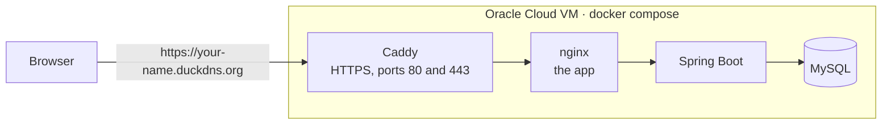

# Deploying the public demo

This guide puts the app on the internet at an HTTPS address an interviewer can open: a free
Oracle Cloud virtual machine running the same Docker Compose setup as local development, with
[Caddy](https://caddyserver.com) in front for HTTPS. It assumes no experience with Linux servers or
Docker. Each step gives the exact commands, what they do and what you should see.

It takes about an hour, most of it waiting.



Only Caddy is reachable from outside. The production setup, `docker-compose.prod.yml`, adds Caddy
to `docker-compose.yml`, takes the database passwords and the domain from a `.env` file that only
the server has, hides every other port, and restarts everything after a crash or a reboot.

**Why HTTPS is not optional:** the cookie that keeps a User logged in is `Secure`, so browsers
only keep it over HTTPS. Over plain `http://` on a public address, every page reload logs the User
out. (`localhost` is the exception, which is why local runs work without it.)

## 1. Create the Oracle Cloud account

1. Go to <https://signup.cloud.oracle.com> and sign up. Oracle asks for a credit card to check
   you're a real person; the Always Free resources this guide uses are never charged.
2. Choose your **home region** carefully: it can't be changed later, and the free Arm VM can only
   be created there. Pick one near you, or one known to have free capacity (Frankfurt, Amsterdam
   and London are often full; smaller regions are often not).
3. Wait for the email saying the account is ready (minutes, sometimes an hour), then sign in at
   <https://cloud.oracle.com>.

## 2. Create the virtual machine

The Always Free tier includes Arm ("Ampere A1") VMs with up to **4 OCPUs and 24 GB of memory in
total**. This guide uses 2 OCPUs and 12 GB, which is plenty and leaves room for a second VM.

1. Open the menu (☰) → **Compute** → **Instances** → **Create instance**.
2. **Name:** `todo-demo`.
3. **Image and shape** → **Edit**:
   - **Change image** → **Ubuntu** → the latest **Canonical Ubuntu 24.04** (not "Minimal") →
     **Select image**.
   - **Change shape** → **Virtual machine** → **Ampere** → **VM.Standard.A1.Flex**. Set
     **OCPUs: 2** and **Memory: 12 GB** → **Select shape**. The form should say *Always Free-eligible*.
4. **Networking:** keep **Create new virtual cloud network** and **Create new public subnet**, and
   check that **Automatically assign public IPv4 address** is on.
5. **Add SSH keys:** choose **Generate a key pair for me** and click **Save private key**. This file
   is the only way into the VM: keep it, and never share it. Move it to `C:\Users\<you>\.ssh\` and
   rename it to `todo-demo.key` (create the `.ssh` folder if it doesn't exist).
6. **Boot volume:** leave the default (about 47 GB; Always Free covers up to 200 GB).
7. Click **Create**. After a minute or two the instance shows **Running**. Note its **Public IP
   address** on the instance page: this guide calls it `<public-ip>`.

### "Out of capacity"

Free Arm VMs are popular, and the region may answer *Out of capacity for shape
VM.Standard.A1.Flex*. Nothing is wrong with your account. In order of effort:

- In **Placement**, choose another **availability domain** (AD-1, AD-2, AD-3, where the region has
  more than one) and try again.
- Try again later: capacity comes and goes, and early mornings and weekends are often better.
- Try a smaller VM: 1 OCPU and 6 GB runs the demo too, more slowly on the first build.
- Upgrade the account to **Pay As You Go** (☰ → **Billing & Cost Management** → **Upgrade and
  Manage Payment**). Upgraded accounts get capacity far more easily, and Always Free resources stay
  free. Anything beyond them would be charged, so create nothing that the form doesn't mark
  *Always Free-eligible*.

## 3. Open ports 80 and 443

Browsers reach the app on port 443 (HTTPS), and Let's Encrypt, which issues the certificate, checks
the domain on port 80 (HTTP). Two firewalls are in the way and both must let them through.

### In Oracle Cloud: the security list

1. On the instance page, under **Primary VNIC**, click the **Subnet** link.
2. Open **Security** (or **Security Lists**) → **Default Security List for vcn-…**.
3. **Security rules** (or **Ingress Rules**) → **Add Ingress Rules**, and add one rule:
   - **Source CIDR:** `0.0.0.0/0` (anyone)
   - **IP Protocol:** TCP
   - **Destination Port Range:** `80,443`
4. **Add Ingress Rules.** The list should now allow 22 (SSH, there from the start), 80 and 443.

### On the VM: its own firewall

This needs a connection to the VM first (next step), so come back here after step 5. Oracle's
Ubuntu images ship firewall rules that reject everything except SSH. Show them with line numbers:

```sh
sudo iptables -L INPUT --line-numbers
```

Find the line with `REJECT` and `reject-with icmp-host-prohibited` (often line 5 or 6) and put two
rules in front of it, replacing `5` with that line's number:

```sh
sudo iptables -I INPUT 5 -p tcp --dport 80 -m state --state NEW -j ACCEPT
sudo iptables -I INPUT 5 -p tcp --dport 443 -m state --state NEW -j ACCEPT
sudo netfilter-persistent save
```

`-I INPUT 5` inserts the rule at that position, before the reject; `netfilter-persistent save`
keeps the rules after a reboot. (Strictly, Docker routes its published ports around these rules,
but opening them keeps the VM's firewall honest about what is reachable.) Listing the rules again should show the two `ACCEPT` lines for
`http` and `https` above the `REJECT`.

## 4. Get a domain name

The certificate needs a domain name, not a bare IP. [DuckDNS](https://www.duckdns.org) gives out
free subdomains:

1. Sign in on <https://www.duckdns.org> (with GitHub or Google).
2. Type a subdomain, for example `ruslan-todo`, and click **add domain**.
3. In its **current ip** field enter `<public-ip>` and click **update ip**.

Your domain is now `ruslan-todo.duckdns.org`; this guide calls it `<domain>`. Check it from
PowerShell on your computer:

```powershell
Resolve-DnsName <domain>
```

The answer should show `<public-ip>`. (A new name can take a few minutes to appear.)

## 5. Connect over SSH from Windows

Windows 10 and 11 come with an SSH client. In PowerShell:

```powershell
ssh -i $HOME\.ssh\todo-demo.key ubuntu@<public-ip>
```

`ubuntu` is the VM's user. The first time, SSH asks whether you trust the server: type `yes`. You
should end up at a prompt like `ubuntu@todo-demo:~$`. Every command from here on runs there, in
that window, unless it says PowerShell. `exit` disconnects.

If SSH refuses the key with *UNPROTECTED PRIVATE KEY FILE*, make the file readable by you alone,
in PowerShell, and connect again:

```powershell
icacls $HOME\.ssh\todo-demo.key /inheritance:r /grant:r "$($env:USERNAME):R"
```

Now go back and open the VM's own firewall (step 3), then bring the system up to date:

```sh
sudo apt-get update && sudo apt-get upgrade -y
```

If a purple screen asks which services to restart, press **Enter** to accept. If it says a restart is required, run `sudo reboot`, wait a minute and connect again.

## 6. Install Docker

These are the commands from [Docker's guide for Ubuntu](https://docs.docker.com/engine/install/ubuntu/):
they add Docker's own package repository and install Docker Engine with the Compose plugin.

```sh
sudo apt-get install -y ca-certificates curl
sudo install -m 0755 -d /etc/apt/keyrings
sudo curl -fsSL https://download.docker.com/linux/ubuntu/gpg -o /etc/apt/keyrings/docker.asc
sudo chmod a+r /etc/apt/keyrings/docker.asc
echo "deb [arch=$(dpkg --print-architecture) signed-by=/etc/apt/keyrings/docker.asc] https://download.docker.com/linux/ubuntu $(. /etc/os-release && echo "${UBUNTU_CODENAME:-$VERSION_CODENAME}") stable" | sudo tee /etc/apt/sources.list.d/docker.list > /dev/null
sudo apt-get update
sudo apt-get install -y docker-ce docker-ce-cli containerd.io docker-buildx-plugin docker-compose-plugin
```

Let the `ubuntu` user run Docker without `sudo`. This takes effect at the next login, so
disconnect and connect again:

```sh
sudo usermod -aG docker ubuntu
exit
```

Back on the VM, check it works:

```sh
docker run --rm hello-world
docker compose version
```

The first prints *Hello from Docker!*; the second a version, 2.24 or later. Docker starts by itself
whenever the VM boots, and starts the app with it.

## 7. Start the app

Download the project:

```sh
git clone https://github.com/RuslanRubtsov/to-do-list.git
cd to-do-list
```

Create its settings from the template. `.env` stays on the server only: Git ignores it.

```sh
cp .env.example .env
openssl rand -hex 24
openssl rand -hex 24
nano .env
```

The two `openssl` commands print two random passwords. In the editor, set `DOMAIN` to `<domain>`
and replace the two passwords with them (right-click pastes into the SSH window). Leave
`COMPOSE_FILE` as it is: it makes every `docker compose` command in this folder use the production
setup. Save with **Ctrl+O**, **Enter**, and leave with **Ctrl+X**.

Build and start everything in the background:

```sh
docker compose up -d --build
```

The first build takes 10 to 15 minutes; later ones are faster. Then see how the services are doing:

```sh
docker compose ps
```

All four (`mysql`, `backend`, `frontend`, `caddy`) should say `Up` and `(healthy)`; the backend
needs a minute or two after starting. Only `caddy` lists ports (`0.0.0.0:80->80/tcp`,
`0.0.0.0:443->443/tcp`).

Caddy asks Let's Encrypt for the certificate as soon as it starts. Watch it happen:

```sh
docker compose logs caddy
```

Look for *certificate obtained successfully*. If it isn't there after a minute, see
[Troubleshooting](#troubleshooting).

## 8. Check it works

From your own computer:

1. **The app:** open `https://<domain>`. It loads, and the browser shows a padlock. Click it to see
   the certificate: issued to `<domain>` by Let's Encrypt (or by ZeroSSL, which Caddy falls back
   to if Let's Encrypt is unavailable).
2. **HTTP redirects:** `http://<domain>` lands on `https://<domain>`.
3. **Swagger UI:** `https://<domain>/swagger-ui/index.html` loads the API documentation.
4. **Staying logged in:** log in as `olena@example.com` with `todo-demo-1`, then reload the page.
   You are still logged in.
5. **Live updates:** log in as `taras@example.com` (same password) in a private window, and open
   *Groceries* in both. A Task Taras adds appears in Olena's window right away.

Put the address into the README's live demo link once it all works.

## Day to day

All of these run on the VM, in the `to-do-list` folder (`cd ~/to-do-list`).

| To | Run |
|---|---|
| See whether everything is up | `docker compose ps` |
| Follow a service's logs (Ctrl+C stops) | `docker compose logs -f backend` |
| See the last 100 lines of every log | `docker compose logs --tail 100` |
| Restart one service, or all | `docker compose restart backend`, `docker compose restart` |
| Stop everything (data is kept) | `docker compose down` |
| Start it again | `docker compose up -d` |

### Update to the latest `master`

```sh
git pull
docker compose up -d --build
docker image prune -f
```

`git pull` downloads the new code, `up -d --build` rebuilds the images and replaces the containers
whose image changed, and `image prune` deletes the old images so they don't fill the disk. The app
is unavailable for the minute the backend takes to start; the database is kept, and so are the
certificate and every User's data.

### Reset the demo data

The demo Users and their Todo Lists are seeded once, into an empty database. To start over from
that state, delete the database's volume (where Docker keeps its files) and start again:

```sh
docker compose down
docker volume rm to-do-list_mysql-data
docker compose up -d
```

This deletes **everything** in the database, including Users that visitors registered. The volume
is named after the folder: `docker volume ls` lists them. Don't use `docker compose down -v`
instead: it also deletes Caddy's volumes and with them the certificate, and Let's Encrypt limits
how often the same certificate can be issued again.

The new database also takes the passwords in `.env` at this point: MySQL only reads them when it
creates the database. To change the passwords, change `.env` and then reset.

## Troubleshooting

### The certificate is not issued

`docker compose logs caddy` shows errors mentioning `acme`, `challenge` or `timeout`. Let's Encrypt
could not reach the VM through `<domain>`. Check, in order:

- **DNS:** `Resolve-DnsName <domain>` in PowerShell answers with `<public-ip>`. If not, update the
  IP on DuckDNS.
- **`DOMAIN` in `.env`:** exactly `<domain>`, without `https://` or a trailing `/`. After a change,
  `docker compose up -d` applies it.
- **The ports:** both firewalls of step 3 allow 80 and 443. From PowerShell,
  `Test-NetConnection <domain> -Port 80` should report `TcpTestSucceeded : True`.

Caddy keeps trying by itself; once the cause is fixed, `docker compose restart caddy` makes it try
straight away. Too many failed attempts and Let's Encrypt pauses the domain for an hour.

### The backend isn't healthy

`docker compose ps` shows `backend` as `unhealthy` or restarting, and the app says it can't reach
the server. Its log says why:

```sh
docker compose logs --tail 200 backend
```

The usual cause is the database password: `Access denied for user 'todo'` means `MYSQL_PASSWORD` in
`.env` changed after the database was created. Put the old one back, or reset the demo data.

### Logged out on every reload

The browser is on `http://`, or on the bare IP address, so it drops the login cookie. Use
`https://<domain>`. If that doesn't load, the certificate is not issued (see above).
